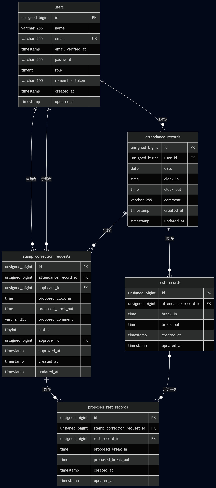

# 勤怠管理アプリケーション

一般スタッフによる日々の打刻（出勤・退勤・休憩）・修正申請機能、および管理者によるスタッフ勤怠管理・修正申請の承認・レポート閲覧機能を備えた統合勤怠管理システムです。

## 使用技術

- **フレームワーク**: Laravel 10.x
- **データベース**: MySQL 8.0
- **Webサーバー**: Nginx
- **メールサーバー（検証用）**: Mailpit
- **開発環境**: Docker / Laravel Sail (WSL 2環境にて動作確認済み)
- **フロントエンド**: Bladeテンプレート / Vite (CSS, JS) / Tailwind CSS
- **認証パッケージ**: Laravel Fortify / Laravel Sanctum

## 開発環境 URL

- **一般ユーザー向け画面（打刻・レポート・申請）**: [http://localhost](http://localhost)
- **一般スタッフ ログイン画面**: [http://localhost/login](http://localhost/login)
- **一般スタッフ 会員登録画面**: [http://localhost/register](http://localhost/register)
- **管理者 ログイン画面**: [http://localhost/admin/login](http://localhost/admin/login)
- **データベース管理（phpMyAdmin）**: [http://localhost:8080](http://localhost:8080)
- **メールボックス（Mailpit）**: [http://localhost:8025](http://localhost:8025)

## 環境構築手順

本アプリケーションをローカル環境で起動するための手順です。

1. **リポジトリのクローン**
   ```bash
   git clone git@github.com:taiga-takeda/attendance-app.git
   cd attendance-app
   ```

2. **環境設定ファイルの準備**
   `.env.example` をコピーして `.env` を作成します。
   ```bash
   cp .env.example .env
   ```
   ※ `.env` ファイル内のデータベース、および Mailpit 接続設定が以下の通りであることを確認してください。
   ```env
   DB_CONNECTION=mysql
   DB_HOST=mysql
   DB_PORT=3306
   DB_DATABASE=laravel
   DB_USERNAME=sail
   DB_PASSWORD=password

   MAIL_MAILER=smtp
   MAIL_HOST=mailpit
   MAIL_PORT=1025
   MAIL_USERNAME=null
   MAIL_PASSWORD=null
   MAIL_ENCRYPTION=null
   MAIL_FROM_ADDRESS="no-reply@example.com"
   MAIL_FROM_NAME="${APP_NAME}"
   ```

3. **初期 Laravel パッケージのインストール**
   手元に PHP 環境がない場合でも、以下の Docker コマンドで安全に初期パッケージをインストールできます。
   ```bash
   docker run --rm \
       -u "$(id -u):$(id -g)" \
       -v "$(pwd):/var/www/html" \
       -w /var/www/html \
       laravelsail/php82-composer:latest \
       composer install --ignore-platform-reqs
   ```

4. **Docker コンテナの起動（Laravel Sail）**
   ```bash
   ./vendor/bin/sail up -d
   ```

5. **依存パッケージおよびフロントエンドのセットアップ**
   ```bash
   ./vendor/bin/sail composer install
   ./vendor/bin/sail npm install
   ```

6. **アプリケーションキーの生成**
   ```bash
   ./vendor/bin/sail artisan key:generate
   ```

7. **データベースのマイグレーションと初期テストデータの投入**
   既存のテーブル構成をリフレッシュし、仕様に完全に適合したダミーデータを生成します。
   ```bash
   ./vendor/bin/sail artisan migrate:fresh --seed
   ```

8. **フロントエンド資産のビルド（Vite の起動）**
   ```bash
   ./vendor/bin/sail npm run dev
   ```

## テスト用ログイン情報

動作確認の際は、以下の Seeder で自動生成されるアカウント情報をご使用ください。

### 1. 一般ユーザー1（統計レポート・API検証用アカウント）
- **メールアドレス**: `user1@example.com`
- **パスワード**: `password`
- **状態**: メール認証済み
- **備考**: ※このユーザはシーディングで10月分の出退勤データを登録しているため、ログインすると「退勤済」の状態となります。過去6ヶ月分のテスト用勤怠データ（総労働時間744時間、遅刻2回、早退1回等）が自動的に登録されており、マイレポート画面の月次トレンドグラフや統計、API一覧取得に即座に反映されます。


### 2. 一般ユーザー2（新規動線検証用アカウント）
- **メールアドレス**: `user2@example.com`
- **パスワード**: `password`
- **状態**: メール認証済み

### 3. 管理者ユーザー3（特権管理アカウント）
- **メールアドレス**: `user3@example.com`
- **パスワード**: `password`
- **状態**: メール認証済み（`admin_status = true`）
- **備考**: 管理者用ログインURL（ `/admin/login` ）からアクセスすることで、全スタッフの出勤簿閲覧や、修正申請の一覧承認・却下アクションを行えます。

## 自動テストの実行

基本要件（ID01〜15）から、今回の応用要件（ID16〜20）にいたるまですべての自動テスト（全78項目・188 assertions）を以下のコマンドで一斉実行し、完全パス（オールグリーン）することを確認済みです。
```bash
./vendor/bin/sail artisan test
```

## 公開APIエンドポイント一覧（V1）

| HTTPメソッド | URI | 説明 | 認証（Laravel Sanctum） |
| :--- | :--- | :--- | :---: |
| **GET** | `/api/v1/attendance-records` | 勤怠一覧取得（検索・絞り込み・meta情報付き） | 不要 |
| **GET** | `/api/v1/attendance-records/{attendanceRecord}` | 勤怠詳細取得（ユーザー・休憩・申請データ含む） | 不要 |
| **POST** | `/api/v1/attendance-records` | 勤怠新規登録（201 Created） | **必須（Bearerトークン）** |
| **PUT/PATCH** | `/api/v1/attendance-records/{attendanceRecord}` | 勤怠更新（本人または管理者のみ許可） | **必須（Bearerトークン）** |
| **DELETE** | `/api/v1/attendance-records/{attendanceRecord}` | 勤怠削除（物理削除・204 No Content） | **必須（Bearerトークン）** |

## ER図


## 作成者
武田大河
